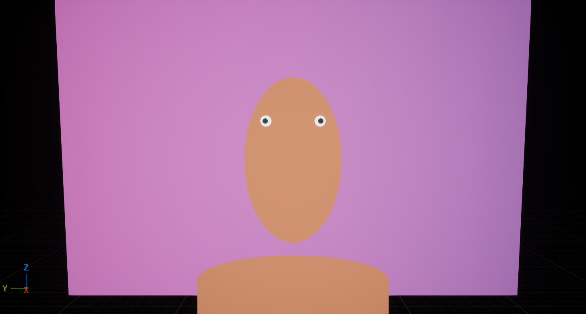

# Sightline Synthetic UE

Lightweight synthetic gaze-data generation for one known MacBook webcam and
display geometry. The project uses Unreal Engine 5.8, MetaHuman-ready scene
structure, a procedural 2D backdrop, deterministic scenario sampling, labelled
gaze rays, Movie Render Queue support, and Epic's native Unreal MCP server.

## Current MVP

The first checked-in scene deliberately uses human-scale primitive meshes rather
than downloading a large MetaHuman library. It proves the expensive-to-correct
parts first:

- camera and display share a fixed physical coordinate system;
- screen `(u, v)` maps to a real 3D target;
- left and right eye rays converge on that target;
- the backdrop is a single asset-free two-colour procedural material;
- each scenario is reproducible from a seed;
- a representative JSON label contains camera, screen, target and binocular ray
  data;
- project-specific tools are available through UE 5.8's native MCP server.

The next visual milestone is to replace the proxy with 6–10 MetaHumans while
keeping the same camera, target, labelling and backdrop interfaces.



This intentionally simple proxy confirms that the camera can resolve both
eyes and irises against a seeded, asset-free procedural background. It is a
geometry and data-path proof, not the intended training appearance.

## Open

1. Connect the T9 external drive.
2. Open `SightlineSyntheticUE.uproject` in Unreal Engine 5.8.
3. If the preview map has not yet been generated, open **Output Log** and run:

   ```text
   py "import sightline; sightline.build_demo_scene(7)"
   ```

4. The script saves `/Game/Sightline/Maps/L_SightlinePreview` and pilots the
   `Sightline_Webcam` CineCamera.

To change the target and background:

```text
py "import sightline; sightline.randomize_preview(42)"
```

## Native Unreal MCP

UE 5.8's experimental **Unreal MCP** and **All Toolsets** plugins are enabled.
The server auto-starts locally at:

```text
http://127.0.0.1:8000/mcp
```

Project-local client configuration is included for Codex, Claude Code, Cursor,
VS Code and compatible clients. The project adds a `SightlineDatasetTools`
toolset with:

- `get_project_status`
- `build_demo_scene`
- `randomize_preview`
- `validate_demo_scene`
- `write_preview_label`

The server binds to loopback only. Do not expose port 8000 to a network: the
experimental UE server has no authentication layer.

## Repository checks

```bash
python3 Scripts/validate_project.py
git lfs install --local
git lfs track
```

Generated datasets, renders, caches and `Saved/` output are ignored. Unreal
binary assets use Git LFS.

Agents should read and update `Docs/UNREAL_5_8_LEARNINGS.md` before changing
the integration. It records UE 5.8 failures and working replacements so the
same editor, MCP, and Python issues are not rediscovered.

## Scope boundary

This repository owns the Unreal data-generation side only. Model training,
Core ML deployment and live webcam inference will live outside this project
once the synthetic schema is stable.
